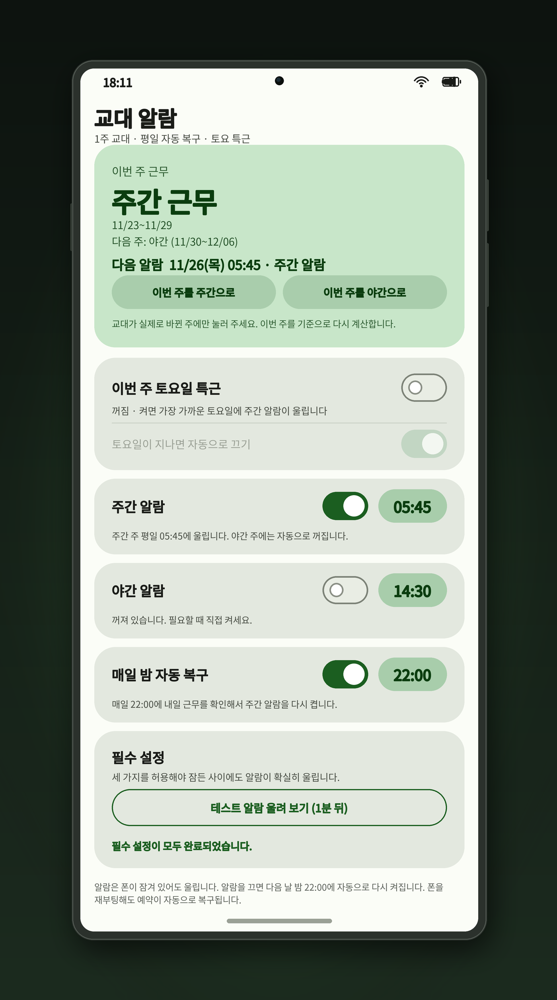

# 교대 알람 (ShiftAlarm)

1주 단위로 주간·야간이 바뀌는 교대 근무자를 위한 안드로이드 알람 앱입니다.
평일에 알람을 꺼 두어도 **매일 밤 22:00에 내일 근무를 확인해 주간 알람을 다시 켜 주고**, 토요 특근이 있으면 스위치 하나로 토요일 알람까지 잡아 줍니다.

**[APK 다운로드 (v1.0.0 · Android 8.0 이상)](https://github.com/twinspapa84/shift-alarm/releases/latest)** · [릴리즈 노트](https://github.com/twinspapa84/shift-alarm/releases/latest) · [웹 안내 페이지](https://twinspapa84.github.io/shift-alarm/) (GitHub Pages를 켠 경우)



## 주요 기능

- **1주 교대 자동 판정** — 이번 주가 주간인지 야간인지 계산해서, 주간 주 평일에는 주간 알람, 야간 주 평일에는 야간 알람만 울립니다. 교대가 실제로 바뀐 주에는 화면의 `이번 주를 주간으로` / `이번 주를 야간으로` 버튼으로 기준을 다시 잡습니다.
- **매일 밤 22:00 자동 복구** — 낮에 알람을 꺼 두어도 그날 밤 내일 근무를 확인해 주간 알람을 다시 켭니다. 야간 주·주말이면 꺼진 채로 정리합니다. 시각은 앱에서 바꿀 수 있습니다.
- **토요 특근 스위치** — 스위치를 켜면 가장 가까운 토요일에 주간 알람 시각으로 울립니다. `토요일이 지나면 자동으로 끄기`를 켜 두면 일요일이 되는 순간 저절로 꺼집니다.
- **정확한 알람** — `AlarmManager.setAlarmClock()`으로 잠든 사이에도 지정한 시각에 울리고, 잠금화면 위로 알람 화면이 뜹니다. 5분 뒤 다시 울리기와 10분 자동 정지를 지원합니다.
- **재부팅·앱 업데이트 후 자동 복구** — 재부팅, 시간·시간대 변경, 권한 변경 시 저장된 설정으로 알람을 다시 예약합니다.
- **인터넷 권한 없음** — 앱이 서버로 보내는 정보가 없습니다. 설정은 폰 안에만 저장됩니다.

## 설치 방법

1. 위의 **APK 다운로드** 링크에서 `ShiftAlarm-v1.0.0.apk`를 폰으로 받습니다.
2. 알림 창이나 파일 앱에서 받은 파일을 눌러 설치합니다.
3. "출처를 알 수 없는 앱" 설치 허용을 물으면 **허용**을 눌러 주세요. (설정 → 앱 → 교대 알람 → 출처를 알 수 없는 앱 설치 허용)
4. 홈 화면의 **교대 알람** 아이콘을 눌러 실행합니다.

이 APK는 디버그 키로 서명되어 있어 스토어를 거치지 않고 바로 설치됩니다. 그래서 설치할 때 위 3번 안내가 한 번 뜹니다.

### 처음 한 번만 하면 되는 설정 3가지

앱 첫 화면의 **필수 설정** 카드에서 순서대로 "허용"을 눌러 주세요.

| 항목 | 왜 필요한가 | 하지 않으면 |
| --- | --- | --- |
| 정확한 알람 권한 | 잠든 사이 지정한 시각에 정확히 울리기 위해 | 알람이 몇 분~몇십 분 늦게 울릴 수 있습니다 |
| 알림 권한 | 알람 화면과 알림을 띄우기 위해 | 화면이 안 뜨고 소리만 날 수 있습니다 |
| 배터리 최적화 예외 | 폰이 앱을 재워 알람을 막는 것을 방지 | 며칠 뒤 알람이 안 울릴 수 있습니다 |

세 개가 끝나면 카드에 **"필수 설정이 모두 완료되었습니다."**가 표시됩니다. 그 아래 **테스트 알람 울려 보기 (1분 뒤)** 버튼으로 잠금화면 위 알람이 실제로 뜨는지 한 번 확인해 두세요.

폰 제조사별로 한 번 더 봐 두면 좋습니다.
- **삼성**: 설정 → 배터리 → 백그라운드 사용 제한 → 교대 알람을 "제한 없음"
- **샤오미·홍미**: 설정 → 앱 → 교대 알람 → 자동 시작 허용, 배터리 절약 → 제한 없음
- 알람 볼륨이 0이 아니어야 하고, 무음·방해 금지 모드에서는 "알람 허용"이 켜져 있어야 합니다.

## 사용법

### 주간 알람
- 기본 시각은 **05:45**이고, 주간 주 평일(월~금)에만 울립니다. 야간 주에는 자동으로 꺼집니다.
- 낮에 스위치를 꺼 두어도 그날 밤 22:00 자동 복구가 다시 켭니다.

### 야간 알람
- 기본은 **꺼짐**입니다. 필요하면 스위치를 켜고 시각을 정하세요(기본 14:30).
- 야간 주 평일에만 울립니다.

### 이번 주 토요일 특근
- 큰 스위치를 켜면 가장 가까운 토요일에 주간 알람 시각으로 울립니다. 야간 주의 특근도 같습니다.
- `토요일이 지나면 자동으로 끄기`가 켜져 있으면 일요일이 되는 순간 꺼집니다. 끄면 다음 토요일로 넘어갑니다.

### 자동 복구
- 기본 **매일 22:00**입니다. 그 시각에 내일이 주간 주 평일이면 주간 알람을 켜고, 아니면 꺼 둡니다.
- 시각은 바꿀 수 있고, 스위치를 끄면 자동 복구를 하지 않습니다.

### 교대 계산 규칙
- 한 주는 월요일 00:00 ~ 일요일 23:59입니다.
- 기본 기준 주는 2026-11-23이 속한 주(주간 주)이고, 거기서 짝수 주 떨어지면 같은 근무, 홀수 주 떨어지면 반대 근무입니다.
- 교대가 실제로 바뀌면 앱에서 그 주를 기준으로 다시 잡으면 그 주부터 1주 간격으로 다시 계산합니다.

## 알람이 안 울릴 때

1. 앱 첫 화면의 **필수 설정 3개**가 모두 사라졌는지(= 허용됨) 확인합니다.
2. 알람 볼륨이 0이 아닌지, 방해 금지 모드에서 알람이 허용되는지 확인합니다.
3. 배터리 최적화 예외와 제조사 백그라운드 제한 해제를 확인합니다.
4. 최근 앱 목록에서 앱을 밀어 강제 종료하면 제조사에 따라 예약이 취소될 수 있습니다. 앱을 다시 열거나 폰을 재부팅하면 자동으로 복구됩니다.
5. 시계 앱의 "다음 알람"에 교대 알람이 보이는지 확인합니다. 정확한 알람으로 등록되면 표시됩니다.

## 알아 두실 점

- **개인 제작 무료 앱**입니다. 판매용이 아니며, 사용 중 생기는 문제에 대한 AS나 보증은 제공하지 않습니다. 중요한 일정은 다른 알람과 함께 확인해 주세요.
- **안드로이드 전용**입니다(iOS 미지원, Android 8.0 이상).
- 디버그 키로 서명한 APK라 Google Play에는 올릴 수 없습니다.
- 앱을 삭제하면 예약된 알람도 함께 사라집니다.

## 개발자용

```bash
# JDK 17 + Android SDK 34
./gradlew testDebugUnitTest      # 핵심 로직 단위 테스트 34개
./gradlew assembleDebug          # app/build/outputs/apk/debug/app-debug.apk
python3 tools/verify.py          # 매니페스트·소스·문자열·레이아웃 정적 검증
```

`.github/workflows/build-apk.yml`은 `main` 브랜치에 푸시하거나 Actions 탭에서 수동 실행하면 단위 테스트를 돌리고 APK를 아티팩트로 올립니다.

### 프로젝트 구조

```
shift-alarm/
├─ .github/workflows/build-apk.yml       # 푸시·수동 실행 시 테스트 + APK 아티팩트
├─ docs/index.html                       # 다운로드 안내 페이지 (GitHub Pages)
├─ app/src/main/java/io/github/twinspapa84/shiftalarm/
│  ├─ core/ShiftConfig.kt                # 설정 데이터 모델
│  ├─ core/ShiftEngine.kt                # 교대 계산·다음 알람·자동 복구 (안드로이드 의존 없음)
│  ├─ data/ShiftPrefs.kt                 # SharedPreferences 저장소
│  ├─ alarm/AlarmScheduler.kt            # setAlarmClock / 복구 / 스누즈 예약
│  ├─ alarm/AlarmReceiver.kt             # 알람 시각에 깨어남
│  ├─ alarm/RestoreReceiver.kt           # 매일 22:00 자동 복구
│  ├─ alarm/BootReceiver.kt              # 재부팅·시간변경·권한변경 재예약
│  ├─ alarm/AlarmService.kt              # 소리·진동·알림 (ForegroundService)
│  ├─ alarm/NotificationHelper.kt        # 알림 채널 + 전체화면 알림
│  ├─ AlarmActivity.kt                   # 잠금화면 위 알람 화면
│  ├─ MainActivity.kt                    # 메인 설정 화면
│  └─ ShiftAlarmApp.kt                   # 앱 시작 시 재예약
├─ app/src/main/res/                     # Material 3 레이아웃·문자열·테마·아이콘
├─ app/src/test/java/.../ShiftEngineTest.kt   # 핵심 로직 단위 테스트
└─ tools/verify.py                       # 정적 검증 스크립트
```

### 동작 원리

```
[매일 22:00] RestoreReceiver ─ 내일 근무 판정 → 주간 알람 ON/OFF → 재예약
      │
      ▼
[알람 시각] AlarmReceiver (setAlarmClock) ─ 다음 알람 미리 예약
      │  · 예약 당시와 설정이 달라졌으면(특근 취소·스위치 OFF) 울리지 않음
      ▼
   AlarmService (ForegroundService)
      ├─ 벨소리(USAGE_ALARM) + 진동 + WakeLock
      ├─ 알림: 전체화면 인텐트 + [해제] [5분 후 다시]
      └─ AlarmActivity: 잠금화면 위로 표시, 뒤로가기로는 꺼지지 않음
      │
      ▼
[해제/다시 울림] 다음 알람과 22:00 복구를 다시 예약
```
